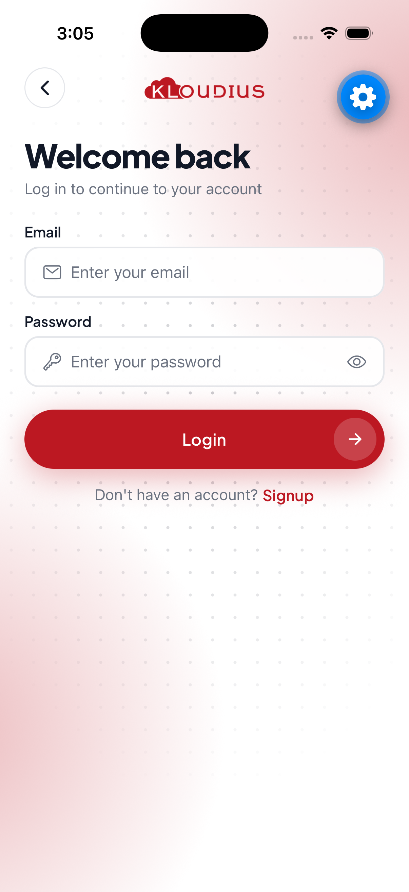
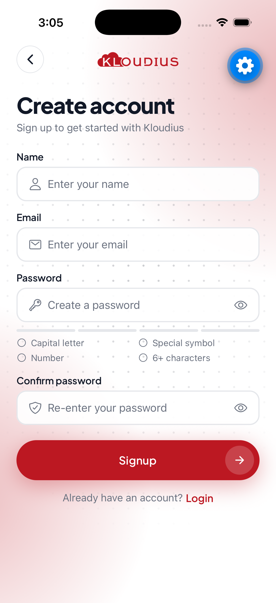
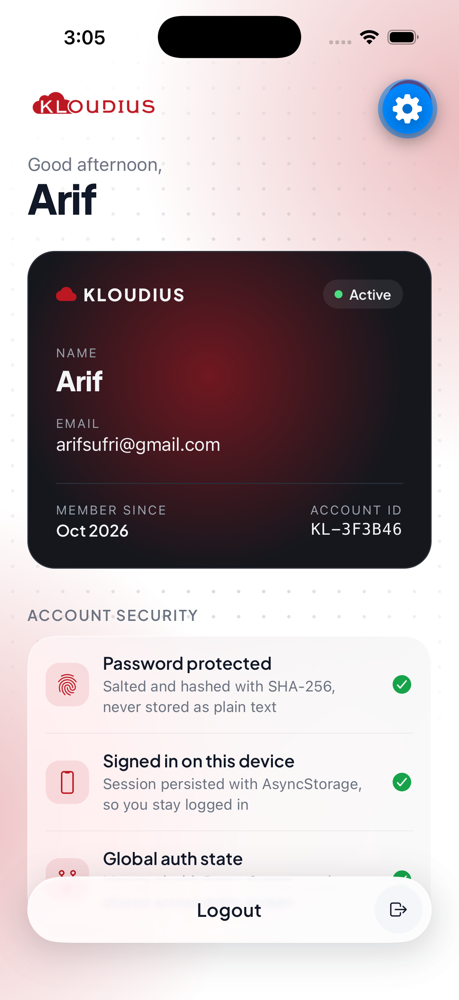
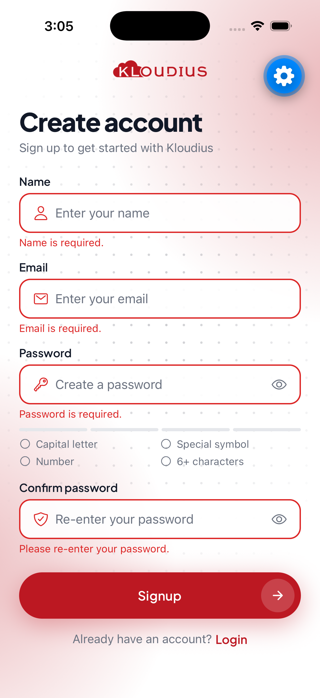
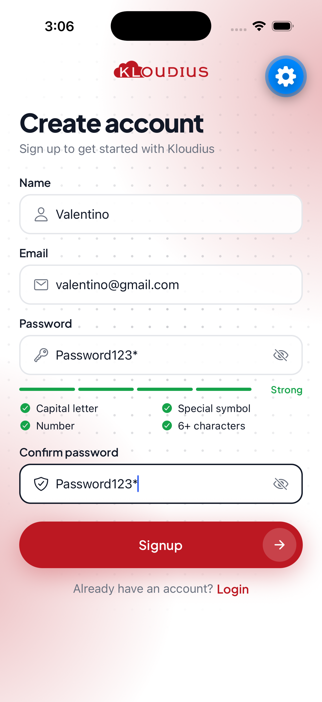

# User Authentication App

A React Native (Expo + TypeScript) app with **Login**, **Signup** and **Home** screens, styled with the Kloudius brand. Authentication state is managed globally with the **React Context API**, navigation uses **React Navigation**, and the session is persisted with **AsyncStorage**.

## Screenshots

| Onboarding | Login | Signup |
| :---: | :---: | :---: |
|  |  |  |

| Home | Validation errors | Password rules + visibility toggle |
| :---: | :---: | :---: |
|  |  |  |

## Tech stack

- [Expo](https://expo.dev) SDK 57 / React Native 0.86 / TypeScript (strict)
- React Context API for auth state
- React Navigation 7 (native stack)
- `@react-native-async-storage/async-storage` for persistence
- `expo-crypto` for password hashing
- `react-native-svg` for the decorative backgrounds
- `expo-glass-effect` for iOS 26 Liquid Glass
- Plus Jakarta Sans via `@expo-google-fonts/plus-jakarta-sans`
- `@expo/vector-icons` (Ionicons)

## Getting started

**Requirements:** Node.js 20+, plus either the [Expo Go](https://expo.dev/go) app on your phone, an iOS Simulator (Xcode), or an Android Emulator.

```bash
git clone <repo-url>
cd kloudius-task
npm install
npm start
```

Then:

- press **i** to open the iOS Simulator
- press **a** to open the Android Emulator
- or scan the QR code with Expo Go (Android) / the Camera app (iOS)

Typecheck with `npx tsc --noEmit`.

## Features

### 1. Authentication context (`src/context/AuthContext.tsx`)

`AuthProvider` wraps the app and exposes the following through the `useAuth()` hook:

| Value | Description |
| --- | --- |
| `user` | The currently logged-in user (`{ id, name, email, createdAt }`) or `null` |
| `login(email, password)` | Logs a user in; throws an `AuthError` for incorrect credentials |
| `signup(name, email, password)` | Creates a new user and logs them in; throws if the email is already registered |
| `logout()` | Clears the session and returns to the Login screen |
| `isRestoring` | `true` while the saved session is loaded on app launch |

`useAuth()` throws if it's used outside the provider, so a missing provider fails loudly.

### 2. Screens

**Onboarding** (`src/screens/OnboardingScreen.tsx`)
- Branded welcome screen shown on first launch, with an animated code-editor illustration that drops in and bounces into place
- **Get started** opens Signup; **Login** opens Login

**Login** (`src/screens/LoginScreen.tsx`)
- Email and password fields
- **Login** button that calls `login` from `AuthContext`
- Inline errors for **missing fields**, an **invalid email format** and a **password shorter than 6 characters**
- A banner error for **incorrect credentials**
- "Don't have an account? **Signup**" link to the Signup screen

**Signup** (`src/screens/SignupScreen.tsx`)
- Name, email, password and confirm password fields
- **Signup** button that calls `signup` from `AuthContext`
- Inline errors for **missing fields**, **invalid email format**, **password shorter than 6 characters** and **passwords that don't match**
- A live password checklist and strength meter: a capital letter, a special symbol, a number and at least 6 characters, each ticked off as you type
- A banner error if the email is already registered
- "Already have an account? **Login**" link back to the Login screen
- New users are logged in immediately after signing up

**Home** (`src/screens/HomeScreen.tsx`)
- Time-based greeting and an account card showing the logged-in user's **name** and **email**, plus their join date and a short account ID. A soft red glow drifts slowly across the card, and it stays still if the device's Reduce Motion setting is on.
- An "Account security" section that explains how the account is protected, rendered with iOS 26 **Liquid Glass** (`expo-glass-effect`). Devices without Liquid Glass get a frosted translucent fallback.
- A floating **Logout** button (with a confirmation prompt) that returns to the Login screen. It slides away while you scroll down and comes back when you scroll up.

### 3. Persistent authentication

The session is saved to AsyncStorage on login and signup, and restored when the app starts (a loading indicator shows while this happens). Users stay logged in after closing and reopening the app until they log out.

### 4. Navigation (`src/navigation/RootNavigator.tsx`)

A native stack navigator that uses React Navigation's [auth-flow pattern](https://reactnavigation.org/docs/auth-flow): the screens it renders depend on `user`.

- Signed out: `Onboarding`, `Login` and `Signup`
- Signed in: `Home`

Logging in or out swaps the screen set, so navigation happens automatically and the back gesture can't return to a screen the user shouldn't see (for example, Home after logging out). After a logout, Onboarding is left out of the stack so the user lands on **Login**, as the spec requires. Switching between Login and Signup replaces the screen rather than stacking it, so Back always returns to Onboarding.

### 5. UI design

- Brand theme in `src/theme.ts`: the Kloudius red (`#BC1822`, sampled from the logo), plus spacing, radius and font tokens
- Reusable components in `src/components/`:
  - `AuthLayout`: shared Login/Signup layout with back button, logo and footer link
  - `Button`: primary and secondary pill variants, loading state, optional trailing icon, press feedback
  - `TextField`: label, leading icon, focus and error states, password visibility toggle
  - `PasswordRequirements`: strength meter and password checklist
  - `ErrorBanner`: form-level errors such as incorrect credentials
  - `BrandBackdrop`: dot grid and soft brand-red glows behind every screen
- Keyboard handling: content stays put while the keyboard slides over it and the focused field scrolls into view; "next" moves to the next field and "go" submits; drag down to dismiss the keyboard
- Errors clear as soon as the user edits the field, and repeat submits are ignored while a request is in flight
- Accessibility labels and roles on inputs, buttons, the password checklist and error messages; the decorative background is hidden from screen readers

### Bonus: password visibility toggle

Every password field has an eye icon that shows or hides the password.

## How the "backend" works

The assignment doesn't include an API, so `src/services/authService.ts` acts as a local mock backend built on AsyncStorage:

- Registered users are stored as a map keyed by lowercase email, so emails are case-insensitive and unique.
- Passwords are **never stored in plain text**. Each user gets a random salt, and the app stores `SHA-256(salt + password)`.
- Login returns the same "Incorrect email or password" message whether the email is unknown or the password is wrong, so it doesn't reveal which accounts exist.
- A short artificial delay simulates network latency, which lets the loading states show.

Because every call goes through this one module, it could be replaced with real API calls without changing the context or the screens.

> Note: this is a demo. A production app would authenticate against a server, hash passwords there with a slow algorithm such as bcrypt or Argon2, and store tokens in secure storage (for example `expo-secure-store`).

## Project structure

```
App.tsx                         # Font loading, providers + NavigationContainer
src/
├── components/
│   ├── AuthLayout.tsx          # Shared layout for Login/Signup
│   ├── BrandBackdrop.tsx       # SVG dot grid + brand glow background
│   ├── Button.tsx
│   ├── ErrorBanner.tsx
│   ├── PasswordRequirements.tsx
│   └── TextField.tsx           # Includes the password visibility toggle
├── context/
│   └── AuthContext.tsx         # AuthProvider + useAuth()
├── navigation/
│   ├── RootNavigator.tsx       # Auth-aware stack navigator
│   └── types.ts                # Typed route params
├── screens/
│   ├── HomeScreen.tsx
│   ├── LoginScreen.tsx
│   ├── OnboardingScreen.tsx
│   └── SignupScreen.tsx
├── services/
│   └── authService.ts          # AsyncStorage-backed mock auth API
├── types/
│   └── user.ts
├── utils/
│   └── validation.ts           # Form validation + password rules
└── theme.ts                    # Colours, fonts, spacing, radius
```

### Conventions

- Imports use the `@/` alias for `src/` (configured in `tsconfig.json`), e.g. `import { useAuth } from '@/context/AuthContext'`.
- Component and screen files are PascalCase (`LoginScreen.tsx`); everything else is camelCase (`authService.ts`).
# kloudius-app
